# ServiceFlow — Product & Architectural Scope (Part A)

**Document Version:** 1.1.0 (Revised & Baseline Approved)  
**Status:** Approved for Implementation  
**Repository Location:** `D:\Projects\serviceflow` (Self-contained)  
**Author:** Senior Full-Stack Engineer / Lead Product Architect  
**Target Market:** Iranian Multi-Branch Café & Restaurant Operations  

---

## 1. Executive Summary & Target Customer

### 1.1 Customer Profile
The initial anchor customer is **"کاراکتر کافه" (Character Café Group)**, a specialty hospitality group operating four high-traffic branches across Tehran:
1. **Enghelab (شعبه انقلاب)**: High-turnover university/cultural district, high volume of espresso beverages and bakery items.
2. **Sanaee (شعبه سنایی)**: Downtown specialty brew-bar and manual pour-over focus.
3. **Shahrak-e Gharb (شعبه شهرک غرب)**: Large suburban dining room with patio and full hot-food kitchen.
4. **Fereshteh (شعبه فرشته)**: Boutique café with specialty cold mocktails and plated pastries.

*Note: All demo entities, branches, staff accounts, and historical orders are strictly synthetic.*

### 1.2 Operating Realities of the Iranian Market
- **Currency & Denominations**: Prices are denominated in **Toman (تومان)** without fractional units (e.g., 85,000 to 320,000 Toman). Real hospitality systems in Iran do not use decimals or cents.
- **Bilingual & RTL Nuances**: Operational displays must accommodate RTL hierarchy, Persian numerals, and typography (Vazirmatn) suited for high-glare kitchen displays and rapid mobile order-taking.
- **Fragmented Technical Ecosystem**: Iranian cafés typically run an isolated desktop POS solely for Shetab bank card processing. Floor coordination happens via paper chits and Telegram/WhatsApp groups.
- **Physical Station Specialization**: Distinct preparation tempos exist across specialized stations:
  - **Barista Bar (بار اسپرسو)**: Fast turnaround (2–5 mins); steam wands, espresso grinders.
  - **Brew Bar (بار دمی)**: Precision manual extractions (6–10 mins); Chemex, V60, Aeropress.
  - **Cold Bar (بار سرد و موکتل)**: Blenders, shaking, ice preparation (4–8 mins).
  - **Kitchen / Bakery (آشپزخانه و بیکری)**: Hot paninis, breakfasts, salads, pastry plating (10–20 mins).
- **Service Friction**: When drinks finish in 3 minutes while hot food takes 18 minutes without synchronized visibility, beverages melt, customer food arrives cold, waiters make unnecessary inquiry trips to the kitchen, and shift managers face customer friction without operational data.

---

## 2. Core Problem & Chosen Workflow

### 2.1 The Core Problem
Café staff coordinate multi-item orders through fragmented, manual tools. Shift managers have zero real-time visibility into station bottlenecks, order dwell times, or comparative branch latency until customer complaints occur.

### 2.2 The Chosen Workflow: Order-to-Service Tracking
We deliberately isolate and master the **Order-to-Service Lifecycle**. This workflow ensures that every item ordered from any table routes to the exact station responsible for it, updates transparently through atomic state changes, alerts staff to ready items, and enables the floor team to complete service with zero silent omissions.

```mermaid
stateDiagram-v2
    [*] --> OrderCreated: Waiter selects Table & adds Items
    OrderCreated --> ItemsQueued: Order Submitted (Order.version = 1)
    
    state "Station Item Queues (Independent)" as Stations {
        state "Barista Bar" as Barista
        state "Brew Bar" as Brew
        state "Cold Bar" as Cold
        state "Kitchen" as Kitchen
    }
    
    ItemsQueued --> Stations: Items dispatched by branch StationType
    
    state "Item Lifecycle (Atomic & Isolated)" as ItemFlow {
        PENDING --> PREPARING: Kitchen accepts (OrderItem.version++)
        PREPARING --> READY: Station completes (OrderItem.version++)
        PENDING --> CANCELLED: Staff cancels item
        PREPARING --> CANCELLED: Staff cancels item
    }
    
    READY --> ServiceFloor: Ready visual/audio badge
    ServiceFloor --> ValidatedServing: Waiter triggers Serve Order
    state ValidatedServing {
        state "Invariant Check: All items READY or CANCELLED?" as Check
    }
    ValidatedServing --> SERVED: Pass (Order.version++)
    ValidatedServing --> Error422: Fail (Unready items exist)
    SERVED --> [*]: Order Completed
```

### 2.3 Detailed Step-by-Step Flow
1. **Table Selection & Order Creation**: Waiter selects an active table in their assigned branch, selects items with Persian culinary modifiers (e.g., "کم‌شیرین", "با یخ اضافه"), and submits the order.
2. **Station Queue Dispatch**: Items route dynamically based on their `station_type` to the physical `KitchenStation` of that branch (`restaurant_id, branch_id, station_id`).
3. **Station Acceptance & Progress**: Station workers see their designated queue in real-time and accept items (`PENDING -> PREPARING`). Updating item state increments `OrderItem.version` independently.
4. **Item Completion & Notification**: Once prepared, the station marks the item `READY`. Item-level status transitions independently of other stations without locking the parent order.
5. **Floor Coordination & Serving**: Waiters observe an aggregated floor view displaying per-item and whole-order status. When all items are delivered, the waiter marks the order `SERVED`. The system verifies all items are in a terminal state (`READY` or `CANCELLED`); otherwise, the action is rejected with `422 Unprocessable Entity`.
6. **Operational Analysis**: Real-time timestamps are recorded at every transition, feeding deterministic bottleneck analytics and an AI-powered operations explainer for shift managers.

---

## 3. Scope Boundaries: What is IN vs. OUT

### 3.1 In Scope (Delivered)
- **Multi-Tenant SaaS Foundation**: Complete database-level and application-level isolation between distinct café groups enforced via composite foreign keys and tenant-scoped queries.
- **Multi-Branch Support**: Single tenant operating multiple physical branches (Character Café Group across 4 Tehran locations).
- **Branch-Aware Station Routing**: Menu items declare target `StationType`; orders resolve to the branch's physical station via composite foreign key `(restaurant_id, branch_id, station_id)`.
- **Role-Based Operational Access**: Strict role enforcement for `manager`, `waiter`, and `kitchen` staff.
- **Granular Station Routing & Concurrency**:
  - Structural order edits bump `Order.version`.
  - Item status transitions bump `OrderItem.version` independently (no conflicts between kitchen updates and waiter order additions).
  - Explicit `409 Conflict` on stale updates.
  - Serving order enforces all items are in terminal state (`READY` or `CANCELLED`).
- **Persian-First Responsive UX**: RTL layout, Vazirmatn typography, Toman formatting, realistic Iranian café demo catalog.
- **Deterministic Metrics Engine**: Millisecond-accurate computation of station lead times, delay frequencies, and branch throughput running 100% in backend SQL.
- **Grounded AI Operational Analyst & Rule-Based Fallback**: Read-only explanation of structured backend metrics with defensive prompt fencing, strict PII elimination, and deterministic fallback.
- **Automated Verification**: End-to-end Pytest suite verifying RBAC, multi-tenancy isolation via composite foreign keys, state machine invariants, optimistic concurrency, and complete order-to-service lifecycles.
- **Unified PostgreSQL Docker Infrastructure**: Single Docker Compose environment using PostgreSQL for both development and testing (no SQLite substitution).
- **Live HTTPS Deployment & Smoke Testing**: Live URL with valid HTTPS certificate and pre-seeded demo credentials.

### 3.2 Out of Scope (Explicitly Excluded)
- **POS Direct Hardware Gateway**: No Iranian Shaparak/Shetab serial EFT-POS hardware protocol drivers.
- **Inventory & Recipe Gram Accounting**: No tracking of coffee bean grams or stock depletion.
- **Payroll & Tip Splitting**: No staff payroll or split payments.
- **Offline-First Synchronizer**: Documented architectural approach for local edge survivability, but full offline CRDT engine is excluded from v1.
- **Customer Self-Ordering Mobile App**: Excluded to focus exclusively on staff coordination speed.

---

## 4. Roles and Permissions Matrix

| Role | Persian Title | Operational Scope | Authorized Actions |
|---|---|---|---|
| **`manager`** | مدیر شیفت / مدیر شعب | All branches of their tenant | View multi-branch operational dashboards, query AI analyst, manage menu/stations/tables, inspect all orders, cancel/override order states. |
| **`waiter`** | سالن‌کار / سفارش‌گیر | Assigned branch | Create orders, add items, view live table & order progress, mark orders as served. Forbidden from managerial metrics and cross-branch data. |
| **`kitchen`** | باریستا / شف آشپزخانه | Assigned branch & station | View assigned station queue (`PENDING`, `PREPARING`), update item preparation status (`PREPARING`, `READY`). Forbidden from creating orders or viewing sales. |

---

## 5. Security & Multi-Tenant Isolation Specification

### 5.1 Composite Foreign Key Enforcement
Tenant and branch isolation is enforced directly at the PostgreSQL schema layer using composite foreign keys:
- `branches (restaurant_id, id)` UNIQUE / PK
- `kitchen_stations (restaurant_id, branch_id, id)` UNIQUE / PK
- `tables (restaurant_id, branch_id, id)` UNIQUE / PK
- `orders (restaurant_id, branch_id, id)` UNIQUE / PK
- `order_items (restaurant_id, branch_id, id)` UNIQUE / PK
- Composite FKs:
  - `orders (restaurant_id, branch_id, table_id)` -> `tables (restaurant_id, branch_id, id)`
  - `order_items (restaurant_id, branch_id, order_id)` -> `orders (restaurant_id, branch_id, id)`
  - `order_items (restaurant_id, branch_id, station_id)` -> `kitchen_stations (restaurant_id, branch_id, id)`

This architecture renders it impossible at the database level for an order item to point to a station belonging to a different branch or tenant.

### 5.2 Server-Side Token Verification & Fail-Closed Boundary
- JWT tokens encode `tenant_id`, `user_id`, `role`, and assigned `branch_id`.
- Client-supplied IDs in request bodies or query params are never trusted as authorization proof.
- Requests attempting to reference resources outside the user's authorized `restaurant_id` return `404 Not Found` (preventing ID enumeration).

---

## 6. Concurrency Strategy & Data Integrity

### 6.1 Concurrency Semantics
1. **Decoupled Item vs. Order Versions**:
   - Kitchen staff updating item states (`PENDING -> PREPARING -> READY`) modify the specific `OrderItem` and increment `OrderItem.version`. This does **not** lock or bump `Order.version`.
   - Waiters appending items or updating order notes modify the root `Order` and increment `Order.version`.
   - Result: A kitchen worker marking a burger as `PREPARING` will **never** conflict with or be overwritten by a waiter adding a drink to the same order.
2. **Optimistic Locking & Conflict Handling**:
   - Mutations provide `expected_version`.
   - Queries perform conditional updates: `WHERE id = :id AND version = :expected_version`.
   - If 0 rows are affected, the API aborts and returns `409 Conflict` along with the latest entity state for clean client re-sync.
3. **Serving Validation Invariant**:
   - An order cannot be marked `SERVED` while any item is `PENDING` or `PREPARING`.
   - Request returns `422 Unprocessable Entity` listing the unready items. Only orders where all items are `READY` or `CANCELLED` can be completed.

---

## 7. AI Operational Analyst Capability & Boundaries

### 7.1 Architecture Principle: Deterministic Facts, Probabilistic Explanations
1. **Deterministic Metrics Engine**:
   - The dashboard and all operational figures (average lead times, station turnaround, delay percentages, top delayed items) are computed 100% deterministically by backend SQL queries.
   - The operational dashboard works completely without the LLM.
2. **Constrained AI Explanation Layer**:
   - The LLM receives pre-aggregated, sanitized JSON (`OperationalEvidence`).
   - Zero customer names or PII are transmitted.
   - Bounded request timeout: LLM calls have a strict 6-second timeout.
   - If the LLM provider fails, times out, or has no API key, the system returns a deterministic, rule-based operational summary generated by Python logic.
   - **Assessment Scope Limitation:** No live Gemini API key is configured or available for this assessment. While the Gemini provider integration is implemented in the codebase (`google-genai`), live API requests have not been executed or verified against Google servers. The deterministic rule-based fallback engine serves as the verified baseline demonstration path.
3. **Prompt Injection Defense In-Depth**:
   - Defense does not rely solely on XML fencing.
   - User queries are sanitized and validated against an allowed operational question whitelist.
   - Parameters are structurally mapped into typed Pydantic payloads.
   - System prompts are anchored with strict system delimiters, instruction precedence, and maximum character length limits.
   - Input containing prompt-override tokens (e.g., `ignore previous instructions`, `system prompt`) are rejected at the API boundary.

---

## 8. Acceptance Criteria

| Criteria | Verification Method |
|---|---|
| **Composite Multi-Tenant Isolation** | Schema enforces composite FKs. Pytest verifies cross-tenant and cross-branch requests are rejected with 404/403. |
| **Independent Item Queues** | Waiter creates multi-station order; items dispatch to branch-specific stations and update independently. |
| **Concurrency Protection** | Simultaneous item updates and order additions succeed without collision; stale writes return explicit `409 Conflict`. |
| **Serving Invariant** | Attempting to serve an order with unready items returns `422 Unprocessable Entity`. |
| **Persian Realism** | Live demo seeds 4 Tehran branches with varied workloads, active delays, served orders, cancelled items, and appended items. |
| **Operational Visibility & Fallback** | Dashboard displays metrics independently of AI; AI explainer returns grounded answers or deterministic Python fallback under failure. |
| **One-Command Setup & HTTPS Deployment** | Single Docker Compose command initializes PostgreSQL and services; deployed application is accessible over HTTPS with demo credentials. |

---

## 9. Time Allocation Budget (6-Hour Hard Cap)

| Phase | Activity | Allocated Time | Target Completion |
|---|---|---|---|
| **Phase 1** | Scope, domain model, revisions, assessment review | 35 min | 0h 35m *(Completed)* |
| **Phase 2** | Backend schema, migrations, composite FKs, RBAC, order workflow APIs | 90 min | 2h 05m |
| **Phase 3** | Frontend responsive café UI (Waiter pad, Kitchen KDS, Manager overview) | 90 min | 3h 35m |
| **Phase 4** | Metrics engine & Grounded AI analyst with deterministic fallback | 40 min | 4h 15m |
| **Phase 5** | Test suite (RBAC, Tenancy, Concurrency 409, Invariants) & Synthetic seed data | 40 min | 4h 55m |
| **Phase 6** | Deployment over HTTPS, live smoke testing, documentation & handover | 65 min | 6h 00m |
